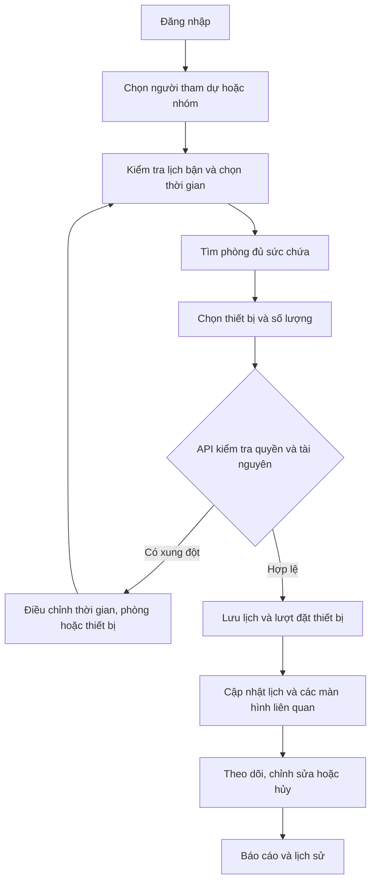
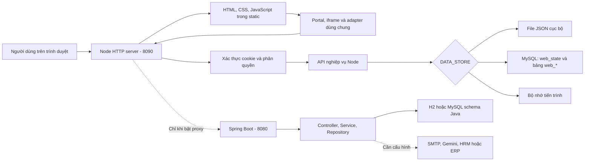
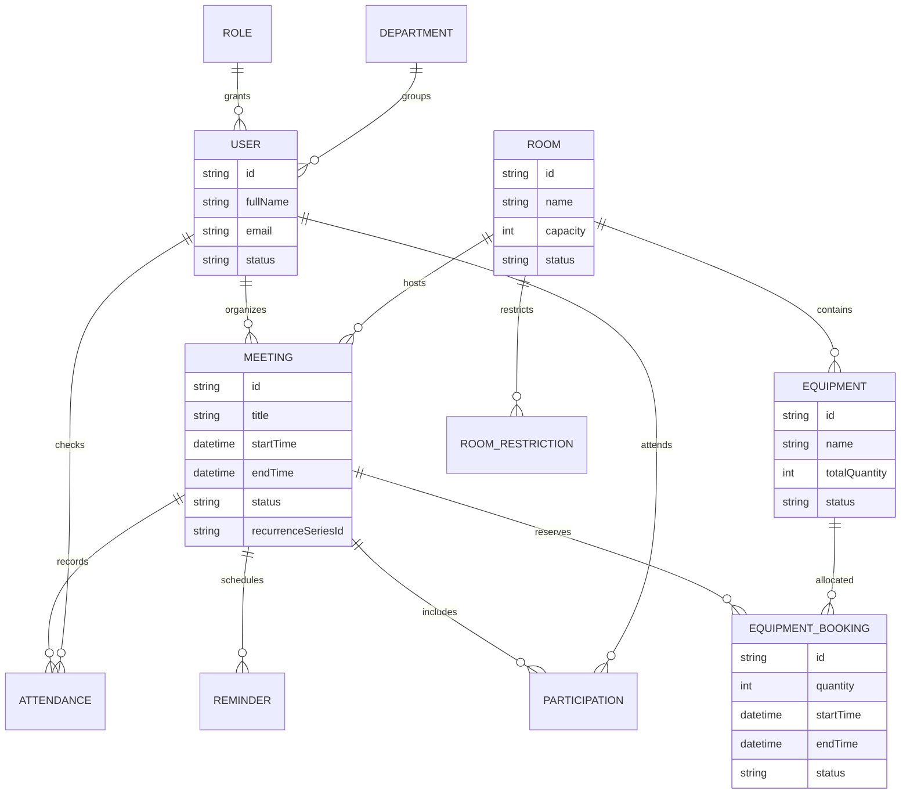
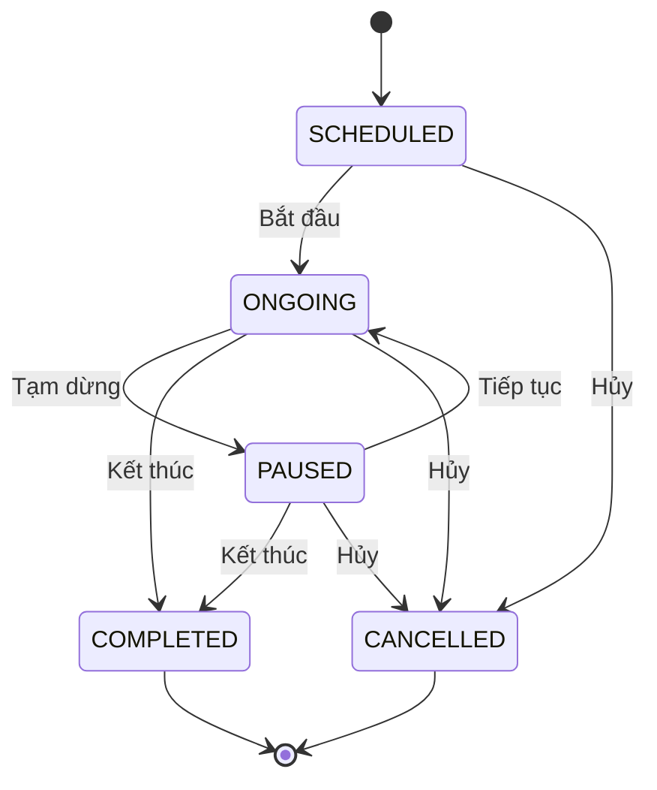
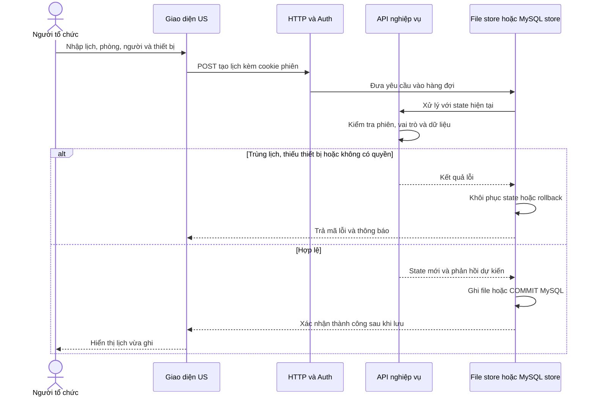
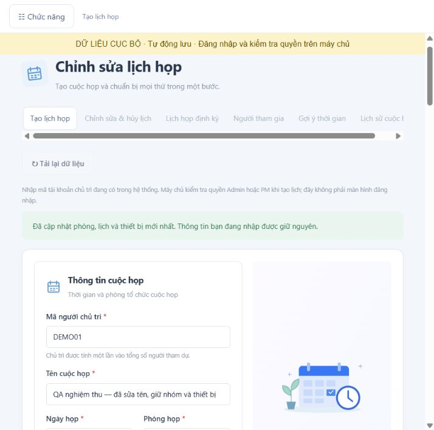
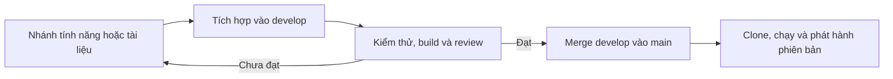

# Meeting — Hệ thống quản lý lịch họp, phòng họp và thiết bị

**Dự án TTCS · Nhóm 4**

**Tài liệu tổng quan và kỹ thuật dành cho Mentor, khách hàng và đội phát triển**

Cập nhật theo mã nguồn tại thư mục dự án ngày **23/10/2026**.

Meeting tập trung việc tổ chức cuộc họp vào một ứng dụng: tìm thời gian phù hợp, chọn phòng, chuẩn bị thiết bị, mời người tham dự, theo dõi lịch và tổng hợp báo cáo. Mục tiêu là giảm thao tác thủ công và phát hiện sớm các xung đột về lịch, sức chứa hoặc số lượng thiết bị.

Repository: [TTCSN4/TTCS_N4](https://github.com/TTCSN4/TTCS_N4).

> **Cách hiểu phiên bản hiện tại:** repository chứa giao diện web, bộ chạy **Node.js** phục vụ bản trình diễn và mã nghiệp vụ **Java/Spring Boot**. Lệnh `node server.cjs` khởi động bản web đang được trình diễn ở cổng **8090**. Lệnh Maven chạy backend Java riêng ở cổng **8080**. Hai backend chưa phải hai hệ thống có thể thay thế hoàn toàn cho nhau về xác thực, hợp đồng API và dữ liệu.

**Gợi ý đọc:** khách hàng có thể bắt đầu với mục 1–5, 16 và 19; Mentor/đội kỹ thuật đọc thêm mục 6–15, 17–18 và 20–24. Để chạy ngay, tới [mục 9](#quickstart). Các sơ đồ dùng Mermaid, có thể xem trực tiếp trên GitHub hoặc trình đọc Markdown hỗ trợ Mermaid.

| Thông tin nhanh | Nội dung |
| --- | --- |
| Lĩnh vực | Quản lý lịch họp, phòng họp, người tham dự và thiết bị trong doanh nghiệp |
| Đối tượng | Admin, người tổ chức/PM, người tham dự/Member |
| Phạm vi giao diện | 28 User Story trong backlog; 27 mục khả dụng, US15 chưa được triển khai trong portal |
| Chạy bản web hiện tại | `npm ci` → `node server.cjs` → `http://127.0.0.1:8090` |
| Nền tảng giao diện | HTML/CSS/JavaScript thuần; portal mở các module dùng chung API |
| Backend và lưu trữ | Node.js cho bản web local; Java 21/Spring Boot trong cùng repository; file JSON, MySQL hoặc H2 theo từng backend |
| Tài liệu trực quan | 6 sơ đồ: nghiệp vụ, kiến trúc, dữ liệu, trạng thái, xử lý yêu cầu và quy trình Git |
| Bằng chứng gần nhất | BE/QA và MySQL thật ngày 23/10/2026; 21/21 tình huống MySQL đạt, chi tiết tại [mục 20](#testing) |

## Mục lục

1. [Dành cho khách hàng: dự án giải quyết vấn đề gì?](#business)
2. [Trạng thái hoàn thiện và phạm vi bàn giao](#scope)
3. [Vai trò và phân quyền](#roles)
4. [Danh mục 28 User Story](#features)
5. [Quy trình nghiệp vụ và kịch bản trình diễn](#workflows)
6. [Kiến trúc tổng thể](#architecture)
7. [Nền tảng, công nghệ và môi trường](#technology)
8. [Cấu trúc thư mục và bản đồ mã nguồn](#structure)
9. [Cài đặt và chạy web từ bản clone sạch](#quickstart)
10. [Chọn chế độ lưu dữ liệu](#storage)
11. [Chạy và phát triển backend Java](#java)
12. [Danh mục cấu hình](#configuration)
13. [Mô hình dữ liệu và cơ sở dữ liệu](#data-model)
14. [Quy tắc nghiệp vụ và thuật toán](#business-rules)
15. [Luồng xử lý yêu cầu và đồng bộ nhiều phiên](#request-flow)
16. [Hướng dẫn sử dụng theo vai trò](#user-guide)
17. [Bản đồ API và ví dụ tích hợp](#api)
18. [Đăng nhập, phiên làm việc và bảo vệ dữ liệu](#security)
19. [Email, chatbot, HRM/ERP, QR và xuất báo cáo](#integrations)
20. [Kiểm thử và bằng chứng xác minh](#testing)
21. [Vận hành, sao lưu và khôi phục](#operations)
22. [Xử lý lỗi thường gặp](#troubleshooting)
23. [Quy trình Git: develop → main](#git-workflow)
24. [Giới hạn hiện tại và hướng phát triển](#roadmap)
25. [Tài liệu tham chiếu và thuật ngữ](#references)

<a id="business"></a>
## 1. Dành cho khách hàng: dự án giải quyết vấn đề gì?

### 1.1. Những bài toán chính

| Vấn đề khi quản lý thủ công | Cách Meeting hỗ trợ |
| --- | --- |
| Người tổ chức phải hỏi từng người xem khi nào rảnh | Tra cứu lịch bận, chọn người hoặc nhóm và gợi ý khung giờ chung |
| Hai cuộc họp cùng đặt một phòng vào cùng giờ | Kiểm tra thời gian chồng lấn khi tìm phòng và khi ghi lịch |
| Chọn phòng nhỏ hơn số người tham dự | Đối chiếu số người với sức chứa phòng |
| Đặt thiết bị vượt tồn kho hoặc dùng thiết bị đang bảo trì | Kiểm tra số lượng khả dụng trong khoảng thời gian đặt |
| Thay đổi lịch ở một màn hình nhưng màn hình khác vẫn dùng dữ liệu cũ | Dữ liệu dùng chung qua API, có cơ chế theo dõi phiên bản để cập nhật giao diện |
| Khó kiểm soát ai được quản lý phòng, thiết bị và tài khoản | Phân vai Admin, PM và Member; kiểm tra quyền ở máy chủ |
| Không có số liệu tổng hợp về sử dụng phòng và lịch hủy | Báo cáo sử dụng phòng, thống kê hủy và tải tệp báo cáo |

### 1.2. Người sử dụng và kết quả nhận được

- **Người tổ chức/PM:** chuẩn bị và điều chỉnh cuộc họp, tìm phòng và thiết bị, theo dõi người tham dự.
- **Người tham dự/Member:** xem lịch có mình tham gia, theo dõi chi tiết và điểm danh trong phạm vi được cấp quyền.
- **Quản trị viên/Admin:** quản lý danh mục phòng, thiết bị, tài khoản và các cấu hình nghiệp vụ.
- **Mentor/đội kỹ thuật:** có mã nguồn giao diện và backend, cấu trúc Maven, hướng dẫn chạy lại và bộ kiểm thử để đối chiếu hành vi.

Kết quả bàn giao là một repository có thể clone và chạy bản web cục bộ; chưa phải gói dịch vụ đã triển khai công khai với SLA, phân tải hoặc kết nối sẵn hệ thống doanh nghiệp.

<a id="scope"></a>
## 2. Trạng thái hoàn thiện và phạm vi bàn giao

### 2.1. Phân biệt ba lớp của dự án

| Thành phần | Vai trò thực tế | Cách sử dụng |
| --- | --- | --- |
| Giao diện HTML/CSS/JavaScript | Không gian Meeting, điều hướng và các màn hình theo US | Một bản nguồn tại `src/main/resources/static` |
| Backend web Node.js | API dùng chung, đăng nhập, phân quyền, dữ liệu mẫu và các nghiệp vụ của bản trình diễn | `node server.cjs` hoặc `npm start` |
| Backend Java/Spring Boot | Mã nghiệp vụ, REST controller, repository, giao dịch và các tích hợp Java | Maven Wrapper; mặc định cổng 8080 |

**“Có giao diện” không đồng nghĩa với “đã kết nối dịch vụ thật”.** Ví dụ, tải báo cáo trong trình duyệt có tạo tệp thực, nhưng thao tác đồng bộ HRM trong bản Node chỉ tạo kết quả mô phỏng. Tương tự, Java có mã kết nối Gemini/SMTP nhưng chỉ hoạt động khi được cấu hình, cấp quyền và kiểm tra đầu cuối với dịch vụ tương ứng.

### 2.2. Mức độ bàn giao

| Hạng mục | Trạng thái theo mã nguồn |
| --- | --- |
| Giao diện theo danh mục portal | 27 mục được bật; US15 chưa có giao diện |
| Chạy lại web từ source | Có; dùng Node.js, không cần chép thêm project US riêng |
| Lưu dữ liệu qua khởi động lại | Có với file JSON hoặc MySQL của bộ chạy Node |
| Phát hiện trùng phòng và kiểm tra thiết bị | Có xử lý tại API Node; Java có các service nghiệp vụ riêng |
| Tài khoản và phiên đăng nhập của bản web | Có; cookie phiên và mật khẩu băm |
| Build và kiểm thử Java | Có Maven Wrapper và bộ kiểm thử |
| Đồng bộ lịch Google/Outlook — US15 | Chưa được bàn giao trong portal hiện tại |
| Hệ thống email/AI/HRM/QR bên ngoài | Phải đọc phạm vi tại [mục 19](#integrations); không mặc định là dịch vụ đã kết nối |
| Chạy production nhiều máy chủ | Chưa được xác minh; cần hoàn thiện theo [mục 24](#roadmap) |

<a id="roles"></a>
## 3. Vai trò và phân quyền

### 3.1. Ma trận quyền của bản web Node

| Nhóm thao tác | Admin | PM | Member |
| --- | :---: | :---: | :---: |
| Xem các màn hình lịch được cấp quyền | Có | Có | Có, US17/US06 và QR mô phỏng theo quyền xem |
| Tạo, chỉnh sửa, hủy lịch và đặt thiết bị | Có | Theo US20; chỉ sửa lịch do mình chủ trì | Không |
| Thêm/sửa/xóa danh mục phòng và thiết bị | Có | Không | Không |
| Cập nhật bảo trì phòng/thiết bị | Có | Không | Không |
| Tạo/quản lý tài khoản không phải Admin | Có | Khi được Admin cấp quyền qua US20 | Không |
| Cấp quyền Admin hoặc thay đổi tài khoản Admin | Có | Không | Không |
| Xem báo cáo | Có | Khi được Admin cấp quyền qua US20 | Không |
| Phản hồi lời mời / điểm danh mô phỏng của mình | Có | Có | Có, với lịch được mời |

Nguồn thực thi: [auth.cjs](tools/web/auth.cjs) và [access-policy.cjs](tools/web/access-policy.cjs). Việc ẩn menu chỉ là phần giao diện; API tiếp tục kiểm tra tài khoản, vai trò và một số điều kiện của dữ liệu gửi lên.

### 3.2. Cách thực thi quyền sau đợt rà soát

1. **US20:** ma trận được dùng ở máy chủ và menu; PM nhận quyền tạo lịch, đặt tài nguyên, quản lý tài khoản và báo cáo theo cấu hình. Admin giữ quyền quản trị phòng/thiết bị/cấu hình; Member chỉ có quyền xem, phản hồi lời mời và điểm danh của mình. Các quyền cố định này không thể vượt qua bằng cách sửa ma trận hoặc gọi API trực tiếp.
2. **US21:** tạo lịch kiểm tra quyền phòng của chủ trì, kể cả khi đặt qua chatbot hoặc adapter cũ. Vai trò PM tương ứng USER và Member tương ứng GUEST của giao diện quyền phòng. Node hiện áp dụng theo vai trò; chính sách riêng theo người/phòng ban thuộc phần cần mở rộng. Java có mô hình restriction riêng.
3. **Quyền trên từng lịch:** PM chỉ thay đổi lịch do mình chủ trì; Member chỉ nhận dữ liệu lịch có mình tham gia, chỉ phản hồi lời mời và điểm danh cho chính mình. Lịch cá nhân được lọc theo tài khoản. Đây chưa phải mô hình phân tách dữ liệu nhiều tổ chức.

Nguồn chính sách chung: [access-policy.cjs](tools/web/access-policy.cjs). Chi tiết ca kiểm tra và giới hạn còn lại: [báo cáo BE/QA](docs/qa/2026-10-23-audit.md).

<a id="features"></a>
## 4. Danh mục 28 User Story

Mã **US** là mã yêu cầu nghiệp vụ. Trong portal, đường dẫn `/#usXX` mở màn hình tương ứng sau khi đăng nhập; quyền tài khoản có thể làm thay đổi các mục nhìn thấy.

| Mã | Chức năng | Phạm vi chính trong bản web |
| --- | --- | --- |
| US01 | Tạo lịch họp | Nhập chủ trì, thời gian, phòng, người tham dự và thiết bị |
| US02 | Chỉnh sửa & hủy lịch | Điều chỉnh lịch dùng chung hoặc hủy để giải phóng tài nguyên |
| US03 | Lịch họp định kỳ | Tạo chuỗi lặp tuần/tháng, khoảng lặp và điều kiện kết thúc |
| US04 | Người tham gia | Xem, thêm/bỏ người tham dự và phản hồi tham gia |
| US05 | Gợi ý thời gian | Xem lịch bận của người/nhóm và tìm khung giờ chung |
| US06 | Lịch sử cuộc họp | Tra cứu lịch đã qua và thông tin liên quan |
| US07 | Phòng trống | Lọc phòng theo thời gian, sức chứa và thông tin phòng |
| US08 | Đặt phòng | Ghi lịch đặt phòng với dữ liệu cuộc họp |
| US09 | Hủy đặt phòng | Hủy lịch đặt, cập nhật trạng thái dùng chung |
| US10 | Kiểm tra sức chứa | Xem sức chứa và đối chiếu nhu cầu người tham dự |
| US11 | Admin quản lý phòng | Danh mục phòng, trạng thái sử dụng, bảo trì/ngừng sử dụng |
| US12 | Đặt thiết bị | Chọn cuộc họp đã có, đặt thiết bị theo số lượng |
| US13 | Trạng thái thiết bị | Kiểm tra tổng, đã đặt, bảo trì và khả dụng theo thời gian |
| US14 | Quản lý thiết bị | Danh mục, số lượng và bảo trì thiết bị |
| US15 | Đồng bộ lịch | **Chưa có giao diện khả dụng trong danh mục hiện tại** |
| US16 | Nhắc lịch & thông báo | Cấu hình và lịch sử nhắc; gửi email trong bản Node là mô phỏng |
| US17 | Lịch họp trên di động | Màn hình lịch thích ứng, chi tiết và tài nguyên PWA |
| US18 | Tạo tài khoản | Tạo người dùng, chọn vai trò và phòng ban |
| US19 | Danh sách tài khoản | Tra cứu, chỉnh sửa và quản lý trạng thái tài khoản |
| US20 | Quản lý vai trò | Ma trận quyền được thực thi tại API và menu; có giới hạn vai trò nêu ở mục 3 |
| US21 | Quyền đặt phòng | Cấu hình và kiểm tra quyền phòng theo vai trò khi ghi lịch; phân biệt Node và Java |
| US22 | Báo cáo sử dụng phòng | Tổng hợp số lượt đặt, thời lượng và tỷ lệ sử dụng |
| US23 | Thống kê lịch đã hủy | Số lượng, xu hướng và nguyên nhân hủy từ dữ liệu có sẵn |
| US24 | Xuất báo cáo | Tạo và tải tệp Excel/PDF trong trình duyệt |
| US25 | Chatbot đặt phòng | Luồng trao đổi/đặt phòng; API Node không gọi mô hình AI thật |
| US26 | Gợi ý phòng họp | Lọc/gợi ý phòng đáp ứng nhu cầu và khung giờ |
| US27 | QR check-in/check-out | Giao diện và lịch sử điểm danh; API Node mô phỏng nghiệp vụ |
| US28 | Đồng bộ HRM/ERP | Cấu hình/trạng thái/lịch sử; API Node trả kết quả mô phỏng |

Danh mục chuẩn: [modules.json](src/main/resources/static/portal/modules.json). Trường `mode` của từng module là metadata lịch sử cách ghép giao diện; không nên dùng riêng trường này để kết luận một API đang chạy ở Node hay Java.

**Riêng US03:** portal hiện trỏ tới `us03/create-meeting.html`. Trong cùng module còn có trang `us03/index.html` dùng `app.js` và `styles.css`. Khi phát triển hoặc báo lỗi, cần nêu rõ đang dùng trang nào; sửa trang phụ chưa chắc làm thay đổi màn hình mở từ portal.

<a id="workflows"></a>
## 5. Quy trình nghiệp vụ và kịch bản trình diễn

### 5.1. Quy trình tổ chức một cuộc họp



### 5.2. Kịch bản trình diễn cho Mentor/khách hàng

| Bước | Thao tác | Điều cần quan sát |
| --- | --- | --- |
| 1 | Đăng nhập bằng Admin | Có các nhóm menu quản trị, lịch, phòng/thiết bị và báo cáo |
| 2 | Tìm phòng đang hoạt động cho một ngày tương lai | Danh sách đáp ứng thời gian và sức chứa |
| 3 | Tạo cuộc họp với người tham dự và 1 thiết bị | Lịch xuất hiện trong dữ liệu chung, số lượng thiết bị khả dụng thay đổi |
| 4 | Thử tạo lịch khác cùng phòng, cùng giờ | Bị từ chối do trùng lịch |
| 5 | Sửa số lượng thiết bị hoặc chuyển khung giờ | Tồn kho được tính lại theo khoảng giờ |
| 6 | Hủy cuộc họp | Lịch có trạng thái hủy; tài nguyên được giải phóng theo kiểm tra nghiệp vụ |
| 7 | Tạo chuỗi định kỳ | Có nhiều lần họp; xung đột ở một lần cần được xử lý, không xác nhận chuỗi dở dang |
| 8 | Chuyển sang PM và Member | PM không sửa danh mục; Member không tạo/sửa lịch |
| 9 | Mở báo cáo và tải Excel/PDF | Số liệu theo bộ lọc và tệp tải xuống tương ứng |
| 10 | Khởi động lại máy chủ file rồi đăng nhập lại | Lịch và tài khoản vẫn còn, phiên đăng nhập cũ hết hiệu lực |

Dùng dữ liệu thử hoặc bản sao dữ liệu cho buổi nghiệm thu. Các thao tác mô phỏng HRM/AI/QR nên được trình bày đúng phạm vi, không dùng như bằng chứng đã kết nối dịch vụ ngoài.

### 5.3. Tiêu chí nghiệm thu nghiệp vụ đề xuất

Bảng này giúp Mentor và khách hàng cùng kiểm tra kết quả trên bản phát hành bàn giao. Đây là danh sách cần chạy khi nghiệm thu, không phải tuyên bố mọi tình huống đã được kiểm thử trực tiếp trên trình duyệt.

| Tình huống | Kết quả cần nhận được |
| --- | --- |
| Tạo lịch với dữ liệu hợp lệ và tài nguyên còn đủ | Có một lịch mới, đúng chủ trì, số người và số lượng thiết bị; tải lại vẫn giữ thông tin |
| Đặt hai lịch cùng phòng 09:00–10:00 và 09:30–10:30 | Lịch thứ hai bị từ chối; lịch đã tồn tại giữ nguyên |
| Đặt hai lịch tiếp giáp 09:00–10:00 và 10:00–11:00 | Không bị coi là trùng phòng; vẫn phải đáp ứng các điều kiện khác |
| Một người được mời vào hai cuộc họp trùng giờ ở hai phòng khác nhau | Phát hiện xung đột người tham dự; không chỉ kiểm tra phòng |
| Số người vượt sức chứa hoặc thiết bị vượt mức khả dụng sau bảo trì | Không ghi lịch/lượt đặt không hợp lệ |
| Sửa riêng tên một lịch đang có nhóm người và nhiều thiết bị | Giữ danh sách người tham dự, số khách và số lượng thiết bị khi các trường đó không bị thay đổi |
| Tạo chuỗi định kỳ có một lần xung đột | Không để lại chuỗi được ghi dở |
| Hủy một lịch còn được phép hủy | Giữ lịch sử hủy và giải phóng lượt đặt thiết bị/nhắc lịch tương ứng |
| PM sửa lịch của người khác hoặc Member gửi yêu cầu ghi lịch | API từ chối, kể cả khi bỏ qua giao diện |
| Lưu thất bại hoặc dữ liệu trên máy chủ đã thay đổi | Không thông báo thành công giả; xử lý lỗi/xung đột trước khi người dùng thao tác tiếp |
| Dừng và mở lại máy chủ dùng file/MySQL | Dữ liệu đã lưu còn tồn tại; người dùng đăng nhập lại |

Khi ghi biên bản, lưu mã phiên bản Git, chế độ lưu dữ liệu, tài khoản/vai trò thử, bước thao tác, kết quả mong đợi và kết quả thực tế. Các tiêu chí email, HRM, AI, QR an toàn và Google/Outlook cần phạm vi nghiệm thu riêng ở [mục 19](#integrations).

<a id="architecture"></a>
## 6. Kiến trúc tổng thể

### 6.1. Sơ đồ các thành phần



Đường nét đứt là lựa chọn cần cấu hình, không phải luồng mặc định. Node không tự khởi động Spring Boot, và Spring Boot không tự khởi động Node.

### 6.2. Vì sao dùng namespace US và portal?

- Các giao diện ban đầu được phát triển theo từng yêu cầu, có thể trùng tên HTML/JS/CSS.
- Mỗi nhóm tài nguyên nằm trong `static/usXX` để tránh ghi đè nhau.
- Portal giữ thanh điều hướng chung và mở module trong `iframe` cùng nguồn.
- `module-bridge.js` chuyển các liên kết giữa module về luồng điều hướng chung.
- Trong chế độ local, máy chủ chèn `demo-client.js` và `live-sync.js` vào HTML được bảo vệ. Adapter cung cấp dữ liệu/phiên cho các module và nối một số giao diện cũ với API chung.

Đây là ứng dụng nhiều màn hình JavaScript thuần được tích hợp chung, không phải một SPA React/Vue có router và state manager thống nhất. Tên `demo-api` phản ánh nguồn gốc bản chạy; dữ liệu phát sinh vẫn được lưu thật khi chọn `file` hoặc `mysql`.

### 6.3. Kiến trúc Java

Luồng chính là **Controller → Service → Repository/JPA/JDBC → Database**. DTO tách dữ liệu yêu cầu/phản hồi; các exception/handler thống nhất một phần xử lý lỗi; Spring Security và kiểm tra tại service bảo vệ nghiệp vụ.

Mã hiện được tổ chức kết hợp theo lớp (`controller`, `service`, `repository`, `model`, `dto`) và theo tính năng (`room`, `equipment`, `recurrence`, `meeting/update`, `chatbot`, `integration/hrm`...). Đây là kết quả hợp nhất nhiều US, chưa phải một cấu trúc package đã chuẩn hóa hoàn toàn.

<a id="technology"></a>
## 7. Nền tảng, công nghệ và môi trường

### 7.1. Công nghệ được khai báo trong repository

| Lớp | Công nghệ/phiên bản | Vai trò |
| --- | --- | --- |
| Giao diện | HTML5, CSS, JavaScript thuần | Form, danh sách, lọc, biểu đồ và điều hướng |
| Tích hợp giao diện | Portal, iframe, Fetch/XHR, DOM events | Dùng chung tài khoản và dữ liệu giữa module |
| Bộ chạy web | Node.js `>=18.17` theo `package.json` | HTTP server, API, crypto, file storage |
| Kết nối MySQL Node | `mysql2` khai báo `^3.24.6`; lockfile khóa bản 3.24.6 | Pool kết nối, truy vấn và giao dịch |
| Ngôn ngữ backend Java | Java target 21 | Service, controller và mô hình nghiệp vụ |
| Framework Java | Spring Boot 4.1.1 | Web MVC, cấu hình và dependency management |
| Truy cập dữ liệu Java | Spring Data JPA, Hibernate, JDBC | ORM và truy vấn nghiệp vụ |
| Bảo mật Java | Spring Security, OAuth2 Resource Server | Kiểm tra quyền; JWT mobile khi bật cấu hình |
| Kiểm tra đầu vào | Jakarta Validation | Validation DTO Java |
| Database | H2; MySQL với JSON/InnoDB | Lưu trữ theo chế độ được chọn |
| Email Java | Spring Mail | Kết nối SMTP khi được cấu hình |
| Excel/PDF Java | Apache POI 5.4.1, PDFBox 3.0.5 | Xuất tệp qua service Java |
| QR Java | ZXing 3.5.3 | Xử lý/tạo mã QR trong phần Java |
| Kiểm thử | Node Test Runner, JUnit, Mockito, Spring Boot Test | Kiểm thử tích hợp và nghiệp vụ |
| Build Java | Maven Wrapper 3.3.4, distribution Maven 3.9.16 | Build lặp lại, không bắt buộc cài Maven riêng |

Các phiên bản trên được đọc từ [package.json](package.json), [package-lock.json](package-lock.json), [pom.xml](pom.xml) và [cấu hình Maven Wrapper](.mvn/wrapper/maven-wrapper.properties), không phải cam kết về phiên bản mới nhất của từng sản phẩm.

### 7.2. Cần cài gì cho từng mục đích?

| Mục đích | Bắt buộc | Không bắt buộc cho luồng này |
| --- | --- | --- |
| Clone và chạy web mặc định | Git, Node.js phù hợp, npm, trình duyệt hỗ trợ JavaScript | Java, Maven cài riêng, MySQL |
| Chạy web với MySQL | Các công cụ trên, MySQL tương thích schema, tài khoản DB | Spring Boot |
| Build/chạy Java | JDK 21 trở lên tương thích build, Maven Wrapper, mạng để tải dependency lần đầu | Node nếu chỉ build Java; MySQL khi dùng H2 |
| Sửa giao diện | Trình soạn thảo mã, trình duyệt, bộ chạy Node | Quy trình bundle frontend riêng |

Mã nguồn có wrapper cho Windows và Linux/macOS. Bằng chứng kiểm tra đã ghi nhận trong dự án là từ môi trường Windows; cần kiểm thử riêng môi trường hệ điều hành/JDK đích trước khi bàn giao vận hành. Chưa có yêu cầu RAM/CPU tối thiểu được đo bằng benchmark tải.

<a id="structure"></a>
## 8. Cấu trúc thư mục và bản đồ mã nguồn

```text
TTCS_N4-WEB-20261020/
├── .mvn/wrapper/                     # Maven Wrapper
├── database/
│   ├── web-schema.sql                # Schema web_* cho bộ chạy Node + MySQL
│   ├── backend/                      # SQL mở rộng cho backend Java
│   └── migrations/                   # Nâng cấp schema Node đang có
├── docs/
│   ├── backend/                      # Tài liệu kỹ thuật theo US
│   ├── consolidation/                # Bằng chứng và lịch sử hợp nhất
│   └── qa/                           # Báo cáo, kết quả và ảnh rà soát BE/QA
├── src/
│   ├── main/
│   │   ├── java/com/ttcs/meetingmanagement/
│   │   │   ├── controller/ service/ repository/ model/ dto/
│   │   │   ├── room/ equipment/ roombooking/ recurrence/
│   │   │   ├── meeting/ user/ rbac/ security/ report/
│   │   │   ├── chatbot/ integration/ notification/ history/
│   │   │   └── MeetingmanagementApplication.java
│   │   └── resources/
│   │       ├── static/
│   │       │   ├── index.html        # Không gian portal
│   │       │   ├── login.html        # Đăng nhập chính của bản web
│   │       │   ├── portal/           # Điều hướng, bridge, adapter, đồng bộ
│   │       │   └── usXX/             # Tài nguyên từng chức năng
│   │       └── application*.properties
│   └── test/java/                    # Kiểm thử Java
├── tools/
│   ├── web/
│   │   ├── server.cjs                # HTTP, phục vụ static, local/proxy
│   │   ├── runtime-config.cjs        # Đọc cấu hình Node
│   │   ├── auth.cjs                  # Tài khoản, phiên, quyền trên tài nguyên
│   │   ├── access-policy.cjs         # Ma trận quyền và quyền phòng dùng chung
│   │   ├── domain-rules.cjs          # Kiểm tra ngày giờ/khoảng thời gian
│   │   ├── demo-api.cjs              # API nghiệp vụ bản web
│   │   ├── demo-seed.cjs             # Dữ liệu mẫu ban đầu
│   │   ├── file-store.cjs            # Lưu file, hàng đợi, rollback
│   │   └── mysql-store.cjs           # Giao dịch MySQL và projection web_*
│   └── tests/
│       ├── integration.test.cjs      # HTTP, module, đăng nhập và dữ liệu
│       ├── business-rules.test.cjs   # Nghiệp vụ, quyền và hoàn tác
│       ├── meeting-participants.test.cjs
│       ├── file-store.test.cjs       # Lưu file, khóa và lỗi ghi
│       ├── mysql-store.test.cjs      # Giao dịch và lỗi pool giả lập
│       ├── report-periods.test.cjs   # Kỳ báo cáo, bao gồm giao năm
│       └── mysql-live.cjs            # Kiểm thử MySQL thật, chạy riêng test:mysql
├── server.cjs                        # Điểm vào: node server.cjs
├── site.config.json                  # Cấu hình web mặc định
├── start-mysql.ps1                   # Chạy Node với MySQL trên Windows
├── package.json / package-lock.json
├── pom.xml
├── mvnw / mvnw.cmd
├── .env.example / .gitignore / .gitattributes
├── API.md
└── README.md
```

Các thư mục `data/`, `node_modules/`, `target/` có thể xuất hiện sau khi chạy/cài đặt/build nhưng được Git bỏ qua. Không cần đưa chúng lên GitHub. Giao diện đang chạy nằm trong `src/main/resources/static`; không cần một bản `public` ở ngoài `src`.

### Bản đồ đọc source theo câu hỏi

| Muốn hiểu hoặc thay đổi | Bắt đầu từ |
| --- | --- |
| Một mục menu mở tệp nào? | [modules.json](src/main/resources/static/portal/modules.json), rồi tới thư mục `static/usXX` tương ứng |
| Vì sao trang cũ vẫn lấy được dữ liệu chung? | [demo-client.js](src/main/resources/static/portal/demo-client.js), [module-bridge.js](src/main/resources/static/portal/module-bridge.js) |
| Đăng nhập hoặc kiểm tra người được phép sửa lịch | [auth.cjs](tools/web/auth.cjs), [access-policy.cjs](tools/web/access-policy.cjs) |
| Vì sao lịch/phòng/thiết bị bị từ chối? | [demo-api.cjs](tools/web/demo-api.cjs), [domain-rules.cjs](tools/web/domain-rules.cjs) và các test nghiệp vụ |
| Thời điểm nào dữ liệu thực sự được ghi? | [file-store.cjs](tools/web/file-store.cjs), [mysql-store.cjs](tools/web/mysql-store.cjs) |
| Vì sao màn hình khác tự cập nhật? | [live-sync.js](src/main/resources/static/portal/live-sync.js) |
| Nghiệp vụ Java được xử lý ở đâu? | [package Java chính](src/main/java/com/ttcs/meetingmanagement/), controller/service theo chức năng và [test Java](src/test/java/) |
| Lỗi nào đã được sửa, còn giới hạn gì? | [Báo cáo BE/QA](docs/qa/2026-10-23-audit.md) và [kết quả xác minh](docs/qa/2026-10-23-verification.json) |

<a id="quickstart"></a>
## 9. Cài đặt và chạy web từ bản clone sạch

### 9.1. Kiểm tra môi trường

```sh
git --version
node --version
npm --version
```

Node phải đáp ứng `engines.node` trong `package.json`. Không mở trực tiếp HTML bằng `file://`: trang cần cùng nguồn HTTP để đăng nhập và gọi API.

### 9.2. Clone và chạy

```sh
git clone https://github.com/TTCSN4/TTCS_N4.git
cd TTCS_N4
npm ci
node server.cjs
```

Mở **[http://127.0.0.1:8090](http://127.0.0.1:8090)**. Có thể thay lệnh cuối bằng `npm start`.

Tại máy đã có source, mở PowerShell trong đúng thư mục dự án. Ví dụ với vị trí đang sử dụng:

```powershell
Set-Location -LiteralPath 'C:\Users\phanc\OneDrive\Desktop\TTCS_N4-WEB-20261020'
npm ci
node .\server.cjs
```

Tên thư mục sau khi clone có thể khác tên thư mục hiện tại; điều quan trọng là terminal nằm cùng cấp với `package.json` và `server.cjs`. `npm ci` cài đúng dependency theo lockfile; frontend hiện không cần `npm run build`.

### 9.3. Đăng nhập lần đầu

Khi chưa có dữ liệu, máy chủ chuẩn bị ba tài khoản khởi tạo:

| Tên đăng nhập | Mã người dùng | Vai trò | Mật khẩu trên bản clone mới |
| --- | --- | --- | --- |
| `admin` | `DEMO01` | Admin | Sinh riêng và in ở terminal, hoặc lấy từ `INITIAL_ADMIN_PASSWORD` |
| `pm` | `DEMO02` | PM | Sinh riêng và in ở terminal, hoặc lấy từ `INITIAL_PM_PASSWORD` |
| `member` | `DEMO03` | Member | Sinh riêng và in ở terminal, hoặc lấy từ `INITIAL_MEMBER_PASSWORD` |

Các mã trên thuộc dữ liệu mẫu của Node, không phải tài khoản Spring Security/Java dùng chung.

- Nếu không đặt mật khẩu qua biến môi trường, chương trình sinh mật khẩu ngẫu nhiên riêng và in ra terminal lúc khởi tạo.
- Khi đã có dữ liệu/credentials, chạy lại không tạo mật khẩu mới. Dùng mật khẩu đã được quản trị viên bàn giao.
- Việc đặt lại mật khẩu trên một máy trình diễn không trở thành mật khẩu mặc định cho người clone, vì `data/` không nằm trong repository.
- Những người dùng mẫu khác trong danh mục không mặc nhiên có thông tin đăng nhập, trừ khi đã được cấp/reset credentials ở dữ liệu của bản chạy đó.

Có thể đặt trước **ba biến `INITIAL_ADMIN_PASSWORD`, `INITIAL_PM_PASSWORD`, `INITIAL_MEMBER_PASSWORD`**, mỗi mật khẩu tối thiểu 12 ký tự, trước lần khởi tạo đầu tiên. Không ghi mật khẩu thật vào source, README hoặc lệnh được chia sẻ công khai. Các biến này không phải chức năng đổi mật khẩu cho dữ liệu đã tồn tại.

### 9.4. Kiểm tra máy chủ và dừng

```powershell
Invoke-RestMethod http://127.0.0.1:8090/__portal/health
```

Kết quả local có các trường như `reachable`, `mode`, `revision`, `storage`. Đây là kiểm tra cơ bản của bộ chạy; không phải kiểm tra toàn bộ tích hợp bên ngoài.

Dừng bằng `Ctrl+C` ở terminal đang chạy. Sau khi khởi động lại, đăng nhập lại; dữ liệu vẫn còn nếu dùng `file` hoặc `mysql`.

<a id="storage"></a>
## 10. Chọn chế độ lưu dữ liệu

### 10.1. So sánh các lựa chọn

| Chế độ | Dữ liệu nằm ở đâu? | Sau khi dừng máy chủ | Mục đích |
| --- | --- | --- | --- |
| Node `file` — mặc định | `data/web-state.json` hoặc `DATA_FILE` | Giữ dữ liệu | Trình diễn, phát triển cục bộ |
| Node `memory` | Bộ nhớ tiến trình | Mất thay đổi | Thử nghiệm có chủ đích |
| Node `mysql` | `web_state` và các bảng `web_*` | Giữ dữ liệu | Dùng MySQL cho bản web |
| Java H2 mặc định | Database H2 trong bộ nhớ | Không giữ qua vòng đời tiến trình | Phát triển/kiểm thử Java |
| Java profile `us03` | H2 file `./data/us03` | Có thể giữ dữ liệu | Luồng Java đã cấu hình profile này |
| Java profile `mysql` | Schema nghiệp vụ Java trên MySQL | Giữ dữ liệu | Backend Java với database đã chuẩn bị |

**Các nơi lưu này độc lập.** Chuyển `DATA_STORE` không tự nhập lịch/tài khoản từ JSON sang MySQL, hoặc từ MySQL `web_*` sang schema Java. Cần một quy trình chuyển đổi riêng nếu muốn chuyển dữ liệu đã có.

### 10.2. File JSON

Đây là lựa chọn chạy nhanh nhất. Store khóa theo PID để hạn chế hai tiến trình cùng ghi một file, xếp hàng các yêu cầu, ghi file tạm rồi thay thế file chính. Khi thao tác ghi thất bại, API khôi phục trạng thái trong bộ nhớ và không xác nhận thành công.

Không sửa trực tiếp JSON khi máy chủ đang chạy. Chỉ dùng một tiến trình cho một file dữ liệu. Không coi OneDrive hay việc sao chép file đang ghi là giải pháp database nhiều máy chủ.

### 10.3. Memory — thử riêng mà không ghi vào dữ liệu file

PowerShell:

```powershell
$env:DATA_STORE = 'memory'
$env:PORT = '8091'
node .\server.cjs
```

Sau khi dừng, bỏ các biến nếu muốn quay lại mặc định trong cùng terminal:

```powershell
Remove-Item Env:DATA_STORE -ErrorAction SilentlyContinue
Remove-Item Env:PORT -ErrorAction SilentlyContinue
```

### 10.4. Node + MySQL

1. Chuẩn bị database và tài khoản kết nối có quyền phù hợp.
2. Đọc và áp dụng [database/web-schema.sql](database/web-schema.sql) vào database đã chọn bằng công cụ quản trị MySQL. Script tạo bảng, không tự tạo database.
3. Kiểm tra máy chủ hỗ trợ kiểu JSON, InnoDB và biểu thức `DEFAULT (JSON_ARRAY())` dùng trong schema.
4. Cài dependency bằng `npm ci`.
5. Chạy trên Windows:

```powershell
.\start-mysql.ps1
```

Script hỏi mật khẩu MySQL và chạy **Node ở cổng 8080**, không phải khởi động Java. Nếu Java đang dùng cổng đó thì phải dừng hoặc chọn cách chạy thủ công với `PORT` khác. Database mặc định là `meeting_management`, user mặc định là `root`; có thể đổi qua biến môi trường.

Schema hiện có trường `participant_groups` trong `web_meeting`. `CREATE TABLE IF NOT EXISTS` không bổ sung cột vào một bảng cũ đã tồn tại. Nếu đang nâng cấp từ schema cũ, xem [migration bổ sung participant_groups](database/migrations/20261023_web_participant_groups.sql), sao lưu và kiểm tra trên database thử trước khi áp dụng; không chỉ chạy lại script rồi giả định schema đã được cập nhật.

Nếu muốn giữ Node ở cổng 8090, có thể chạy thủ công sau khi chuẩn bị schema:

```powershell
$env:DATA_STORE = 'mysql'
$env:PORT = '8090'
$env:DB_HOST = '127.0.0.1'
$env:DB_PORT = '3306'
$env:DB_NAME = 'meeting_management'
$env:DB_USERNAME = 'root' # Thay bằng tài khoản database được cấp
$meetingDbSecret = Read-Host 'Mật khẩu MySQL' -AsSecureString
try {
    $env:DB_PASSWORD = [System.Net.NetworkCredential]::new('', $meetingDbSecret).Password
    node .\server.cjs
} finally {
    Remove-Item Env:DB_PASSWORD -ErrorAction SilentlyContinue
    $meetingDbSecret.Dispose()
}
```

Trong cùng cửa sổ, `DATA_STORE` vẫn là `mysql` sau khi dừng. Để quay về file, đặt `$env:DATA_STORE = 'file'` trước khi chạy lại. Không dùng ví dụ này để tự chuyển dữ liệu giữa hai store.

`mysql-store.cjs` không tự chạy DDL. Nó đọc snapshot từ `web_state`, cập nhật các bảng projection trong giao dịch và dùng `is_deleted` để đánh dấu những dòng đã bị bỏ khỏi danh mục. Không sửa tay các bảng projection để thay cho snapshot: lần đồng bộ sau có thể ghi lại chúng từ `web_state`.

<a id="java"></a>
## 11. Chạy và phát triển backend Java

### 11.1. Lệnh Windows

```powershell
java -version
.\mvnw.cmd test
.\mvnw.cmd package
.\mvnw.cmd spring-boot:run
```

### 11.2. Lệnh Linux/macOS

```sh
chmod +x mvnw
./mvnw test
./mvnw package
./mvnw spring-boot:run
```

Backend mặc định dùng `application.properties`, cổng **8080**, H2 memory và JPA `ddl-auto=update`. JAR sau khi package:

```sh
java -jar target/meetingmanagement-0.0.1-SNAPSHOT.jar
```

Với Java + MySQL, chuẩn bị schema nghiệp vụ Java rồi bật profile:

```powershell
$env:SPRING_PROFILES_ACTIVE = 'mysql'
.\mvnw.cmd spring-boot:run
```

Profile này dùng `ddl-auto=validate`: schema không khớp thì khởi động có thể thất bại. SQL trong `database/backend/` là các phần mở rộng theo US, không nên coi đó là một bộ migration từ database trống đã bao phủ mọi bảng và mọi phiên bản.

### 11.3. Những khác biệt cần lưu ý

- Cookie `ttcs_session` của Node không tự trở thành principal/JWT của Spring Security.
- Java mặc định chưa bật cấu hình JWT mobile. Khi bật, cần cung cấp secret Base64 hợp lệ, issuer và audience.
- `RbacSecurityConfig` có các quy tắc endpoint riêng và từ chối nhiều API chưa được khai báo quyền. Việc có controller/service không có nghĩa endpoint đã sẵn sàng cho phiên đăng nhập Node.
- Đường dẫn tạo lịch, định dạng ID/DTO và cách lưu trạng thái của hai backend có điểm khác nhau. Ví dụ Node có `/api/meetings/create`; Java dùng controller tạo lịch tại `/api/meetings`.
- Tài khoản khởi tạo của Node không tự được tạo trong database Java.

Vì vậy, để mở bản web đang được bàn giao, vẫn dùng `node server.cjs`. Chế độ proxy chỉ nên dùng khi đang phát triển/kiểm tra adapter API và xác thực với backend Java đã chuẩn bị.

<a id="configuration"></a>
## 12. Danh mục cấu hình

### 12.1. Node.js

Thứ tự ưu tiên chính là **biến môi trường → `site.config.json` → giá trị mặc định**.

```json
{
  "mode": "local",
  "storage": "file",
  "port": 8090,
  "backendUrl": "http://127.0.0.1:8080"
}
```

| Cấu hình | Mặc định/phạm vi | Tác dụng |
| --- | --- | --- |
| `PORT` / `port` | `8090` | Cổng Node; số nguyên 1–65535 |
| `DATA_STORE` / `storage` | `file` | `file`, `memory` hoặc `mysql` |
| `DATA_FILE` | `data/web-state.json` | Đổi file lưu; đường dẫn tương đối được giải theo thư mục làm việc của tiến trình |
| `APP_MODE` / `mode` | `local` | `proxy` chuyển API sang backend riêng |
| `DEMO_MODE` | Được suy ra từ mode | Nếu đã đặt, `1` bật API local; giá trị khác chuyển khỏi local |
| `BACKEND_URL` / `backendUrl` | `http://127.0.0.1:8080` | Backend proxy; hiện chỉ chấp nhận HTTP loopback |
| `DB_HOST`, `DB_PORT` | `127.0.0.1`, `3306` | Kết nối MySQL của Node |
| `DB_USERNAME`, `DB_PASSWORD` | `root`, phải cung cấp mật khẩu | Tài khoản MySQL của Node |
| `DB_NAME` | `meeting_management` | Database MySQL của Node |
| `INITIAL_ADMIN_PASSWORD` | Sinh ngẫu nhiên nếu thiếu | Mật khẩu Admin trong lần khởi tạo credentials đầu |
| `INITIAL_PM_PASSWORD` | Sinh ngẫu nhiên nếu thiếu | Tương tự cho PM |
| `INITIAL_MEMBER_PASSWORD` | Sinh ngẫu nhiên nếu thiếu | Tương tự cho Member |

**File `.env` không được tự nạp bởi `runtime-config.cjs`.** `.env.example` chỉ là mẫu tên biến. Với PowerShell, đặt bằng `$env:TEN_BIEN = 'gia-tri'`; với shell POSIX, dùng `export TEN_BIEN=...`. Không giả định tạo `.env` là ứng dụng tự đọc.

Ví dụ chạy cổng khác:

```powershell
$env:PORT = '8091'
node .\server.cjs
```

### 12.2. Java và tích hợp

| Nhóm | Cấu hình tiêu biểu | Ghi chú |
| --- | --- | --- |
| Spring profile | `SPRING_PROFILES_ACTIVE` | Chọn `mysql`, `us03`, `us16`, `us25`, `us28` theo nhu cầu |
| MySQL Java | `DB_URL`, `DB_USERNAME`, `DB_PASSWORD` | JDBC URL khác với bộ biến host/port/name của Node |
| SMTP | `SMTP_HOST`, `SMTP_PORT`, `SMTP_USERNAME`, `SMTP_PASSWORD`, `SMTP_AUTH`, `SMTP_STARTTLS`, `MAIL_FROM` | Cần dịch vụ SMTP thực hoặc server mail thử |
| Nhắc lịch | `REMINDER_ENABLED`, `REMINDER_SCAN_MS`, `REMINDER_MAX_RETRIES` | Mặc định chung tắt nhắc tự động; profile US16 có cấu hình riêng |
| Gemini | `GEMINI_API_KEY`, `GEMINI_MODEL`, `GEMINI_BASE_URL` | Đọc mặc định chi tiết trong profile/service US25 |
| HRM/ERP | `HRM_INTEGRATION_ENABLED`, `HRM_BASE_URL`, `HRM_SNAPSHOT_PATH`, `HRM_API_KEY`, `HRM_WEBHOOK_KEY` | Đối tác phải đáp ứng hợp đồng payload |
| Đồng bộ HRM | `HRM_SYNC_INTERVAL_MS`, `HRM_INITIAL_DELAY_MS`, timeout kết nối/đọc | Không đồng nghĩa đã có kết nối khi chưa cấu hình |
| JWT mobile | `app.mobile.jwt.enabled`, `app.mobile.jwt.secret`, `app.mobile.jwt.issuer`, `app.mobile.jwt.audience` | Đặt dưới dạng Spring properties; mặc định disabled |
| QR Java | `QR_HMAC_SECRET`, `QR_ISSUER_SECRET` | Khóa tạo/xác thực token và quyền phát hành |
| PDF Java | `report.pdf.font-path` | Font phù hợp cho nội dung tiếng Việt |

Các giá trị nhạy cảm được cấp qua môi trường/cấu hình triển khai; README không chứa mật khẩu bàn giao của máy đang chạy.

<a id="data-model"></a>
## 13. Mô hình dữ liệu và cơ sở dữ liệu

### 13.1. Sơ đồ miền nghiệp vụ

Sơ đồ dưới đây biểu diễn **quan hệ nghiệp vụ**, không khẳng định mọi cạnh đều được khai báo bằng foreign key ở cả hai backend.



### 13.2. Snapshot của Node

State của bản web chứa `rooms`, `equipment`, `users`, `meetings`, `equipmentBookings`, `attendance`, `hrmHistory`, `reminders`, `roomGrants`, `extra` và `revision`.

- `extra` chứa các cấu hình/phần mở rộng, ví dụ nhóm người tham dự và credentials đã băm.
- `legacy` là dạng dữ liệu tương thích cho những giao diện cũ; không phải một database khác.
- Dữ liệu mẫu được sinh trong `demo-api.cjs` và `demo-seed.cjs` khi khởi tạo. Khi có state đã lưu, store phục hồi dữ liệu thay vì mặc định thay toàn bộ bằng mẫu mới.
- Credentials không được trả trong snapshot công khai của API; file/database lưu state vẫn cần được bảo vệ vì chứa dữ liệu nội bộ.

### 13.3. Các bảng MySQL của bộ chạy Node

| Bảng | Nội dung |
| --- | --- |
| `web_state` | Snapshot JSON toàn bộ state, revision và thời điểm cập nhật; hiện dùng bản ghi `id=1` |
| `web_room` | Danh mục phòng, sức chứa, trạng thái, vị trí |
| `web_user` | Thông tin người dùng và vai trò để tra cứu |
| `web_equipment` | Danh mục thiết bị, số lượng tổng và số không khả dụng |
| `web_meeting` | Lịch họp, thời gian, trạng thái, người tham dự/nhóm ở dạng JSON |
| `web_equipment_booking` | Lượt đặt thiết bị theo lịch và số lượng |

`web_state` là nguồn để phục hồi state của ứng dụng. Năm bảng danh mục/nghiệp vụ còn lại là các bản biểu diễn quan hệ phục vụ tra cứu, được cập nhật cùng giao dịch. Schema có primary key và một số index theo phòng/thiết bị/thời gian; hiện không khai báo đầy đủ foreign key giữa các bảng `web_*`.

Nhắc lịch, lịch sử HRM, điểm danh và credentials trong bản Node không có bảng `web_*` riêng tương ứng trong script này; chúng nằm trong snapshot. Vì vậy chỉ sao lưu `web_meeting` không đủ để khôi phục toàn bộ hệ thống.

### 13.4. Schema Java

Các entity Java ánh xạ những bảng như `user`, `role`, `department`, `room`, `meeting`, `meeting_participant`, `equipment`, `equipment_bookings`, `room_restriction`, `notification`, `meeting_recurrence`, `hrm_sync_runs`.

Không dùng `database/web-schema.sql` thay cho schema Java. Các ID có thể khác kiểu; chẳng hạn lượt đặt thiết bị Java dùng ID số, còn Node thường dùng chuỗi ghép từ ID cuộc họp và thiết bị. Khi tích hợp cần chuyển đổi DTO/schema thay vì nối trực tiếp chỉ vì tên nghiệp vụ giống nhau.

<a id="business-rules"></a>
## 14. Quy tắc nghiệp vụ và thuật toán

### 14.1. Thời gian và trùng phòng

Bản Node kiểm tra ngày thực, giờ hợp lệ và điều kiện kết thúc sau bắt đầu; ngày không tồn tại như 30/02 bị từ chối. Các mốc thời gian lịch được chuẩn hóa về UTC+07:00; chuỗi không có offset được hiểu theo UTC+07:00. Khi gọi API, nên gửi ISO-8601 có offset, ví dụ `2030-12-10T09:00:00+07:00`, tránh phụ thuộc múi giờ của máy khách.

Hai khoảng được coi là trùng khi:

```text
startA < endB AND startB < endA
```

Khoảng được hiểu theo dạng `[bắt đầu, kết thúc)`. Cuộc họp 09:00–10:00 và cuộc họp 10:00–11:00 có thể tiếp giáp mà không trùng. Lịch đã hủy được loại khỏi kiểm tra giữ phòng. Chủ trì và người tham dự cũng được kiểm tra trùng lịch khi tạo/sửa hoặc thêm lời mời; người đã từ chối không chiếm lịch bận của lần mời đó. Thời gian tạo/sửa phải ở tương lai. Khi chỉnh sửa phải loại chính lịch đang sửa ra khỏi phép kiểm tra xung đột.

### 14.2. Sức chứa và danh sách tham dự

- Chủ trì được tính đúng một lần trong danh sách; các định danh trùng được gộp.
- Tài khoản tham dự phải tồn tại và đang hoạt động. Không cho bỏ chủ trì ra khỏi danh sách.
- Nhóm/phòng ban được mở rộng thành danh sách người dùng ở các luồng có hỗ trợ. Lịch lưu danh sách tại thời điểm đặt; thay đổi nhóm sau đó không tự thay đổi các lịch cũ.
- `participantCount` là tổng số chỗ cần dùng, gồm người có tài khoản và khách chưa có định danh. Tổng không được nhỏ hơn số người có định danh hoặc vượt sức chứa phòng. Khách chưa có định danh không có lịch bận riêng để kiểm tra.
- Khi sửa riêng thông tin lịch mà không gửi danh sách người/thiết bị, giữ dữ liệu hiện có. Khi thêm/bỏ người có định danh, cập nhật tổng và giữ số khách đã khai báo.
- Thêm nhiều người được kiểm tra cả danh sách trước khi ghi; lỗi một người không để lại danh sách cập nhật một phần.
- Phòng phải đang ở trạng thái được phép đặt và chủ trì có quyền phòng. Việc UI đã lọc phòng không thay thế bước kiểm tra lại tại API.

### 14.3. Tồn kho thiết bị theo thời gian

Tồn kho vật lý và số lượng khả dụng là hai khái niệm khác nhau:

```text
Khả dụng trong khoảng giờ
  = Tổng số lượng vật lý
  - Số lượng đang bảo trì/không sử dụng được
  - Mức đặt đồng thời lớn nhất trong khoảng giờ
```

Hàm tính đặt đồng thời của Node gom các sự kiện bắt đầu/kết thúc lượt đặt, sắp theo thời gian và tìm mức sử dụng cao nhất. Sự kiện kết thúc được xử lý trước bắt đầu ở cùng mốc, phù hợp quy tắc lịch tiếp giáp.

Ví dụ có 2 TV: đặt 1 TV từ 09:00–10:00 thì cùng khoảng đó còn 1; sang 10:00 nếu không có lượt đặt khác thì số khả dụng được tính lại. Hủy lượt đặt không làm tăng “tổng thiết bị vật lý”; nó chỉ bỏ phần chiếm dụng thời gian.

Các API tạo/sửa lượt đặt, tạo/sửa cuộc họp và bảo trì đều kiểm tra tồn kho khả dụng. Sửa thông tin lịch giữ nguyên số lượng thiết bị nếu không gửi thay đổi; mỗi lượt đặt có định danh duy nhất, khoảng đặt nằm trong cuộc họp. Việc thay đổi một nhánh cần có kiểm thử hồi quy cho các nhánh khác; không nên mặc định mọi endpoint có mức validation giống hệt nhau.

### 14.4. Gợi ý thời gian

Luồng US05 lấy lịch bận của những người được chọn, so sánh giao nhau và đề xuất khung giờ chung. Trong implementation Node hiện tại, gợi ý có bước quét 30 phút trong khung 08:00–18:00, với thời lượng nguyên từ 15 đến 480 phút. Đây là quy ước hiện có, chưa phải bộ lịch làm việc/ngày nghỉ tùy biến cho từng doanh nghiệp.

### 14.5. Lịch định kỳ

API Node hỗ trợ `WEEKLY`/`MONTHLY`, khoảng lặp, thứ trong tuần/ngày trong tháng và giới hạn bằng số lần hoặc ngày kết thúc. Hiện kiểm tra khoảng lặp 1–52 và chuỗi tối đa 100 lịch. Các ngày không tồn tại trong tháng sẽ không tạo được lần họp theo điều kiện ngày đó.

Khi tạo chuỗi, mỗi lần vẫn phải qua kiểm tra phòng, người và thiết bị. Nếu có lỗi trong lúc tạo, implementation phục hồi danh sách lịch/lượt đặt trước khi xác nhận. Giới hạn và thuật toán Java riêng phải được xem trong package `recurrence`; không áp giới hạn Node cho Java bằng suy đoán.

### 14.6. Trạng thái cuộc họp

Sơ đồ phản ánh endpoint chuyển trạng thái chuyên biệt của bản Node:



API chuyển trạng thái là `POST /api/demo/meeting-status`. Trạng thái không tự chuyển theo đồng hồ. Luồng sửa thông tin chỉ nhận lịch `SCHEDULED`; không dùng PUT để mở lại lịch `COMPLETED` hoặc `CANCELLED`. Khi hủy, lịch sử được giữ lại, lượt đặt thiết bị và nhắc lịch tương ứng chuyển sang hủy. Java có luồng trạng thái riêng cần đối chiếu khi tích hợp.

### 14.7. Cơ sở tính báo cáo

API báo cáo sử dụng phòng Node loại lịch đã hủy, cộng thời lượng các lịch trong kỳ và dùng giả định **8 giờ/phòng/ngày** để tính giờ khả dụng. Công thức/tập dữ liệu của báo cáo Java hoặc màn hình tổng hợp phía client có thể khác. Cần thống nhất lịch làm việc, cuối tuần, ngày nghỉ, cách tính lịch qua ngày và thời gian đặt chồng trước khi dùng KPI để báo cáo quản trị chính thức.

<a id="request-flow"></a>
## 15. Luồng xử lý yêu cầu và đồng bộ nhiều phiên

### 15.1. Lưu một cuộc họp trong bản local



File store xếp hàng trong một tiến trình và thử lại có giới hạn khi Windows/OneDrive tạm khóa thao tác đổi tên file. Chế độ memory cũng xếp hàng yêu cầu để tránh dùng nhầm actor giữa các yêu cầu đồng thời. MySQL store thêm giao dịch, khóa bản ghi snapshot bằng `SELECT ... FOR UPDATE` và cập nhật các bảng projection. Cơ chế này giúp giữ tính nhất quán cho bản chạy nhưng chưa chứng minh khả năng mở rộng ngang: snapshot đơn và các thao tác tuần tự có thể trở thành điểm nghẽn.

### 15.2. Cập nhật dữ liệu giữa các màn hình

`live-sync.js` kiểm tra `revision` khoảng mỗi **2 giây** khi tài liệu đang hiển thị, đồng thời kiểm tra lại khi quay về tab hoặc lấy focus.

- Revision đổi: tải state mới và phát sự kiện `ttcs-data-updated`.
- Module có xử lý sự kiện riêng có thể cập nhật dữ liệu tại chỗ.
- Module chưa có xử lý riêng có thể tải lại; nếu đang có bản nháp thì hiện thông báo để tránh mất nội dung nhập.
- Hết phiên: đưa người dùng về đăng nhập.
- Nhiều lần lỗi kết nối: hiện thông báo chưa đồng bộ được.

Đây là **polling**, không phải WebSocket hay cơ chế đồng bộ Google/Outlook của US15. Tài nguyên PWA cũng không có nghĩa các thao tác ghi API sẽ hoạt động khi mất mạng.

<a id="user-guide"></a>
## 16. Hướng dẫn sử dụng theo vai trò

### 16.1. Admin — chuẩn bị danh mục

1. Đăng nhập tại trang `login.html` của máy chủ đang chạy.
2. Mở **Phòng & thiết bị → Admin quản lý phòng**: kiểm tra tên/mã, vị trí, sức chứa và trạng thái.
3. Mở **Quản lý thiết bị**: thêm/sửa danh mục, số lượng và phòng sở hữu thiết bị.
4. Khi bảo trì, nhập đúng số lượng đưa vào sửa hoặc đã sửa xong; không coi việc sửa một thiết bị là hoàn tất toàn bộ số lượng đang bảo trì.
5. Mở **Người dùng & quyền** để tạo tài khoản, chọn vai trò/phòng ban và kiểm tra trạng thái hoạt động.
6. Xem US20/US21 cùng các giới hạn thực thi tại mục 3 trước khi sử dụng để phân quyền chi tiết.

### 16.2. PM — tạo và điều chỉnh lịch

1. Kiểm tra tài khoản PM được cấp quyền tạo lịch/đặt tài nguyên. PM dùng chính mình làm chủ trì; chọn người tham dự hoặc dùng **Gợi ý thời gian** để kiểm tra lịch bận trước.
2. Chọn ngày và khoảng giờ; tìm phòng đủ sức chứa, đang hoạt động.
3. Mở **Tạo lịch họp**, kiểm tra chủ trì, tên, thời gian, phòng, mô tả và danh sách tham dự.
4. Chọn thiết bị, nhập số lượng; kiểm tra thông báo khả dụng trước khi xác nhận.
5. Sau khi lưu, đối chiếu ở danh sách lịch/phòng/thiết bị.
6. Dùng **Chỉnh sửa & hủy lịch** nếu thay đổi kế hoạch. Khi chuyển phòng, kiểm tra lại danh mục thiết bị của phòng mới.
7. Nếu đặt thiết bị sau khi tạo lịch, vào US12 và chọn cuộc họp sắp tới đã có.

### 16.3. Lịch định kỳ

1. Mở **Lịch họp định kỳ** từ portal.
2. Nhập các thông tin cuộc họp và quy tắc lặp phù hợp với form đang dùng.
3. Kiểm tra xem trước các lần diễn ra, số lần/ngày kết thúc và tài nguyên.
4. Xử lý xung đột nếu một lần họp bị trùng. Không xem việc hiển thị được preview là lịch đã được lưu.
5. Đối chiếu các lịch thực tế sau khi API xác nhận thành công.

### 16.4. Member — xem lịch và điểm danh

1. Đăng nhập bằng tài khoản đang hoạt động; mở **Lịch của tôi/US17** hoặc **Lịch sử/US06**.
2. Lọc theo ngày, tên và trạng thái; chỉ đọc các lịch có mình tham gia.
3. Mở chi tiết để kiểm tra thời gian, phòng và chủ trì.
4. Nếu cần trình diễn điểm danh, vào US27, chọn lịch của mình và thực hiện check-in trước check-out. Node lưu record mô phỏng; chưa phải xác thực hiện diện qua QR an toàn.

Menu tạo/sửa và quản trị không được cấp cho Member; yêu cầu trực tiếp API ghi vẫn bị kiểm tra quyền. API hỗ trợ phản hồi lời mời cho chính mình; màn hình US04 hiện thuộc nhóm chức năng của người tổ chức, nên không coi đây là luồng phản hồi tự phục vụ đã hoàn thiện trên giao diện Member.

### 16.5. Báo cáo và tải tệp

Chọn khoảng ngày và phòng, áp dụng bộ lọc trước khi đọc tổng số liệu. Trong US24, chọn định dạng Excel hoặc PDF rồi tải tệp. Báo cáo được dựng từ dữ liệu màn hình đang lấy, nên cần tải/cập nhật dữ liệu trước nếu vừa có thay đổi ở phiên khác. Đối chiếu quy ước tính số liệu tại mục 14.7.

<a id="api"></a>
## 17. Bản đồ API và ví dụ tích hợp

### 17.1. Quy ước

- URL dưới đây là đường dẫn tương đối tới **bộ chạy Node**; ví dụ base URL `http://127.0.0.1:8090`.
- Dữ liệu gửi chủ yếu là JSON, dùng `Content-Type: application/json`.
- Phần lớn API cần cookie phiên. Các đường dẫn health/catalog có vai trò riêng.
- ID thường là chuỗi; phải lấy từ dữ liệu thực tế, không suy đoán ID của Java và Node giống nhau.
- Bảng là bản đồ các nhóm API chính, không thay thế việc đọc toàn bộ validation trong code.

| Nhóm | Method và đường dẫn tiêu biểu | Nội dung |
| --- | --- | --- |
| Đăng nhập | `POST /api/auth/login`, `POST /api/auth/logout`, `GET /api/auth/me` | Tạo/hủy/kiểm tra phiên |
| Sức khỏe | `GET /__portal/health` | Trạng thái cơ bản của bộ chạy |
| Danh mục UI | `GET /portal/modules.json` | Các US và entry point |
| Lịch họp | `GET /api/meetings`, `GET /api/meetings/{id}` | Danh sách/chi tiết |
| Ghi lịch | `POST /api/meetings/create`, `POST /api/meetings`, `PUT /api/meetings/{id}`, `DELETE /api/meetings/{id}` | Tạo, sửa, hủy |
| Định kỳ | `POST /api/meetings/recurring` | Tạo chuỗi lịch |
| Trạng thái lịch | `POST /api/demo/meeting-status` | Chuyển trạng thái theo sơ đồ mục 14.6 |
| Phòng | `GET/POST /api/rooms`, `GET/PUT/DELETE /api/rooms/{id}` | Danh mục và nghiệp vụ phòng |
| Phòng trống | `GET /api/rooms/availability`, `GET /api/rooms/available` | Tra cứu theo thời gian/sức chứa |
| Gợi ý phòng | `POST /api/rooms/suggestions` | Đề xuất phòng |
| Trạng thái phòng | `POST /api/rooms/{id}/status`, `POST /api/rooms/{id}/restore` | Bảo trì, khôi phục trạng thái |
| Thiết bị | `GET/POST /api/equipment`, `GET/PUT/DELETE /api/equipment/{id}` | Danh mục |
| Tồn kho | `GET /api/equipment/status` | Số lượng theo phòng và thời gian |
| Đặt thiết bị | `GET/POST /api/equipment/bookings`, `PUT/DELETE /api/equipment/bookings/{id}` | Đặt, đổi số lượng, hủy |
| Bảo trì thiết bị | `POST /api/equipment/{id}/maintenance`, `POST /api/equipment/{id}/restore` | Điều chỉnh lượng đang sửa |
| Tham dự | `GET/POST /api/meetings/{id}/participants`, `DELETE/PATCH /api/meetings/{id}/participants/{userId}` | Thành viên và phản hồi |
| Nhóm | `GET/POST /api/participant-groups`, `DELETE /api/participant-groups/{id}` | Nhóm người dùng |
| Thời gian | `POST /api/availability/conflicts`, `POST /api/availability`, `POST /api/meetings/suggestions` | Lịch bận và khung giờ chung |
| Tài khoản | `GET/POST /api/users`, `PUT /api/users/{id}` | Người dùng |
| Vai trò/phòng ban | `GET /api/roles`, `GET /api/departments`, `PUT /api/admin/users/{id}/role` | Danh mục và gán vai trò |
| Quyền phòng | `GET/PUT /api/room-permissions` | Cấu hình/lịch sử quyền |
| Lịch cá nhân/lịch sử | `GET /api/mobile/calendar`, `GET /api/meetings/history`, `GET /api/users/{id}/meeting-history` | Tra cứu lịch |
| Báo cáo | `GET /api/admin/reports/room-usage` | Số liệu sử dụng phòng |
| Nhắc lịch | `GET/POST /api/meetings/{id}/reminders`, `POST /api/reminders/dispatch` | Nhắc lịch trong phạm vi bản chạy |
| Điểm danh | `POST /api/check-in`, `POST /api/check-out`, `GET /api/meetings/{id}/check-in-logs` | Lưu lịch sử thao tác |
| Chatbot | `POST /api/chatbot/message`, `POST /api/chatbot/book-room` | Luồng trao đổi và đặt phòng |
| HRM | `GET /api/integrations/hrm/status`, `GET /api/integrations/hrm/history`, `POST /api/integrations/hrm/pull` | Kết quả mô phỏng ở Node |
| Adapter giao diện cũ | `GET /api/demo/state`, `GET /api/demo/revision`, `POST /api/demo/legacy` | State/revision và dữ liệu tương thích |

### 17.2. Ví dụ payload tạo lịch

```json
{
  "title": "Họp đánh giá tiến độ",
  "organizerId": "DEMO01",
  "roomId": "A101",
  "participants": ["DEMO01", "DEMO02"],
  "participantCount": 3,
  "startTime": "2030-12-10T09:00:00+07:00",
  "endTime": "2030-12-10T10:00:00+07:00",
  "description": "Đánh giá tiến độ và các công việc tiếp theo",
  "equipment": [
    { "equipmentId": "A101-EQ5", "quantity": 1 }
  ]
}
```

Payload minh họa gửi tới `POST /api/meetings/create`; ví dụ có 2 người có định danh và 1 khách, tổng 3 chỗ. Các ID phải tồn tại trong bản chạy; cùng payload có thể bị từ chối nếu phòng/thiết bị đang bận hoặc tài khoản không có quyền. PM phải thay `organizerId` bằng mã của chính mình. Khi sửa, có thể bỏ các trường người tham dự/thiết bị để giữ giá trị hiện tại; gửi một danh sách mới là yêu cầu thay đổi danh sách đó.

Ví dụ tra cứu thiết bị trong một khoảng:

```text
GET /api/equipment/status?room=A101&at=2030-12-10T09%3A00%3A00%2B07%3A00&endTime=2030-12-10T10%3A00%3A00%2B07%3A00
```

### 17.3. Mã phản hồi thường gặp

| HTTP | Ý nghĩa thường gặp |
| --- | --- |
| `200` / `201` | Xử lý hoặc tạo thành công |
| `400` | Đầu vào không hợp lệ |
| `401` | Chưa đăng nhập, phiên hết hạn hoặc sai thông tin đăng nhập |
| `403` | Không đủ quyền hoặc nguồn yêu cầu không hợp lệ |
| `404` | Không tìm thấy tài nguyên/đường dẫn |
| `409` | Xung đột: trùng lịch, thiếu thiết bị, dữ liệu trùng hoặc trạng thái không cho phép |
| `429` | Đăng nhập sai quá nhiều lần |
| `503` | Không lưu được dữ liệu/kết nối store, hoặc backend proxy chưa sẵn sàng |

API Node thường trả lỗi có `message` và `mode`. Khi tích hợp Java cần đọc DTO/lỗi của controller Java tương ứng, không dùng bảng hợp đồng Node như thể hai backend đồng nhất.

<a id="security"></a>
## 18. Đăng nhập, phiên làm việc và bảo vệ dữ liệu

### 18.1. Cơ chế đang có trong bản Node

- Mật khẩu được băm bằng **scrypt** với salt ngẫu nhiên; không khôi phục ngược mật khẩu từ hash.
- Token phiên sinh ngẫu nhiên, lưu trong bộ nhớ máy chủ; cookie tên `ttcs_session`, có `HttpOnly`, `SameSite=Strict`, thời hạn 8 giờ.
- Đăng xuất loại phiên; restart máy chủ làm mất các phiên cũ nhưng không xóa người dùng đã lưu.
- Các thao tác ghi có kiểm tra nguồn yêu cầu; API có kiểm tra quyền và một số quy tắc bảo vệ tài khoản Admin.
- Đăng nhập sai được giới hạn theo địa chỉ: sau nhiều lần sai trong một cửa sổ ngắn, API trả `429`.
- Tài khoản bị khóa không được đăng nhập; khóa tài khoản không đồng nghĩa đã xóa lịch của người đó.
- Thông tin xác thực chứa hash và salt nằm trong state nội bộ; API snapshot loại phần credentials khỏi phản hồi thông thường.

Mật khẩu khởi tạo qua môi trường yêu cầu ít nhất 12 ký tự. Hàm cấp mật khẩu khi tạo người dùng qua API hiện yêu cầu ít nhất 8 ký tự và tối đa 72 byte UTF-8. Việc quản trị viên đặt lại mật khẩu trong dữ liệu cục bộ không thay đổi các quy tắc này trong source.

### 18.2. Những ranh giới chưa nên giả định

Bản web local chưa có SSO, MFA, quy trình quên mật khẩu qua email, quản lý phiên phân tán hay nhật ký kiểm toán đầy đủ. Cookie hiện phục vụ HTTP loopback, chưa phải cấu hình HTTPS production hoàn chỉnh. Phân quyền tài nguyên chi tiết, phân lập dữ liệu theo người/phòng ban và việc thống nhất các nhánh validation cần được rà soát tiếp.

Các dữ liệu cá nhân, file backup state, mật khẩu/secret và thông tin kết nối thực không thuộc source bàn giao công khai. `.gitignore` loại `data/`, `node_modules/`, `target/`, `.env` và một số nội dung cục bộ; vẫn cần kiểm tra `git status` trước mỗi lần commit.

<a id="integrations"></a>
## 19. Email, chatbot, HRM/ERP, QR và xuất báo cáo

| Hạng mục | Bản Node đang trình diễn | Phần Java/công việc tích hợp |
| --- | --- | --- |
| Email/nhắc lịch | Lưu cấu hình/record và trạng thái như `SENT_DEMO`; không chứng minh thư đã gửi tới hộp thư thật | Có Spring Mail, lịch quét và retry; cần SMTP, cấu hình và kiểm tra gửi/nhận |
| Chatbot/AI | Endpoint message trả hướng dẫn mô phỏng; xác nhận đặt phòng dùng dữ liệu chung | Có service Gemini; cần API key, dịch vụ bên ngoài và kiểm thử quyền/đầu vào |
| HRM/ERP | Lưu lịch sử thao tác và trả kết quả mô phỏng, không tự lấy nhân sự từ hệ thống thật | Có client pull/webhook/sync; cần base URL, khóa tích hợp và hợp đồng dữ liệu |
| QR/điểm danh | Có màn hình, record check-in/out, từ chối thao tác trùng và check-out trước check-in | Java có mã token/HMAC và ZXing; cần khóa, quyền phát hành và kiểm tra với thiết bị/camera thực |
| Xuất Excel/PDF | US24 dựng tệp thực ở trình duyệt từ dữ liệu đã lọc | Java có endpoint Excel/PDF bằng POI/PDFBox, nhưng còn phụ thuộc xác thực/quyền và cấu hình font |
| PWA/di động | Có manifest, service worker và icon cho US17 | Không bảo đảm offline booking, thông báo push hoặc hỗ trợ mọi thiết bị |
| Google/Outlook Calendar | US15 chưa có giao diện khả dụng trong portal | Cần hoàn thiện OAuth, mapping, đồng bộ và xử lý xung đột nếu được đưa vào phạm vi tiếp theo |

Tệp PDF của US24 hiện được dựng qua canvas/ảnh trong trang PDF; đây chưa phải báo cáo văn bản nhiều trang có thể tìm kiếm và đã tối ưu cho mọi khối lượng dữ liệu. Nhãn “kết nối” hoặc một kết quả “success” ở phần mô phỏng không thay thế biên bản kiểm tra với hệ thống đối tác.

<a id="testing"></a>
## 20. Kiểm thử và bằng chứng xác minh

### 20.1. Chạy kiểm thử

```sh
npm test
```

```powershell
.\mvnw.cmd test
.\mvnw.cmd verify
```

`npm test` chạy các tệp `tools/tests/*.test.cjs`, tạo dữ liệu tạm riêng rồi dọn sau khi xong; không dùng file `data/web-state.json` của người sử dụng để làm fixture.

### 20.2. Những gì bộ kiểm thử kiểm tra

| Nhóm | Nội dung chính |
| --- | --- |
| Khởi động web | Mặc định chạy API local; chặn yêu cầu dữ liệu chưa đăng nhập |
| Giao diện/tài nguyên | Truy cập các entry của 27 module và các tài nguyên liên quan |
| Lịch và thiết bị | Tạo/sửa/hủy, từ chối trùng phòng, kiểm tra tồn kho và hoàn trả khi hủy |
| Tài khoản/quyền | Đăng nhập, tài khoản tạo mới, hạn chế Admin/PM/Member |
| Lưu dữ liệu | Khởi động lại vẫn có dữ liệu; lỗi ghi file không được xác nhận thành công |
| Đồng thời | Các yêu cầu cùng lúc không làm mất các record được kiểm tra |
| Java | Các service lịch/định kỳ, người tham dự, phòng, quyền, báo cáo, tài khoản, chatbot, HRM, nhắc lịch và thao tác đồng thời theo bộ test hiện có |

### 20.3. Kết quả đã ghi nhận và cách đọc

Bằng chứng gần nhất gồm [báo cáo BE/QA ngày 23/10/2026](docs/qa/2026-10-23-audit.md), [JSON BE/QA](docs/qa/2026-10-23-verification.json) và lượt [kiểm thử MySQL thật](docs/qa/2026-10-23-mysql.md), được tóm tắt ở mục 20.4–20.5. JSON ghi cả commit nền và việc kiểm tra có thay đổi chưa commit; số liệu không được hiểu là kết quả của mọi bản clone hoặc mọi commit sau đó.

Các báo cáo hợp nhất ngày **22/10/2026** là bằng chứng lịch sử: [UNIFIED-VERIFICATION.json](docs/consolidation/UNIFIED-VERIFICATION.json), [BROWSER-VERIFICATION.json](docs/consolidation/BROWSER-VERIFICATION.json). Chúng ghi 67 kiểm thử Java, 8 mục Node và 27 màn hình ở phiên bản khi đó. Một số file còn có đường dẫn/ghi chú “chưa push” cũ; đó không phải trạng thái Git hiện tại.

Khi phát hành, chạy lại các kiểm tra phù hợp với thay đổi rồi ghi nhận phiên bản source và môi trường. Chỉnh sửa README không tự tạo một lượt kiểm thử ứng dụng mới.

Kết quả test không đồng nghĩa đã kiểm tra tải lớn, nhiều máy chủ, lỗi mạng thực tế dài hạn, camera thật, bảo mật toàn diện, tính tương thích mọi trình duyệt hay mọi tích hợp bên ngoài. Repository hiện không được giả định có CI tự chạy chỉ vì đã có lệnh kiểm thử; cần kiểm tra workflow thực tế trên nhánh Git đang dùng.

### 20.4. Đợt rà soát BE/QA ngày 23/10/2026

Đợt rà soát bổ sung kiểm thử hồi quy cho quyền trên từng lịch, quyền phòng/ma trận, người tham dự, tồn kho và bảo trì, lịch định kỳ, ghi danh sách nguyên khối, lỗi file và giao dịch MySQL. Kết quả: **38 kiểm thử Node đạt**, **68 kiểm thử Java đạt**, **27 màn hình mở và hiển thị được trên trình duyệt**, không ghi nhận lỗi console trong lượt kiểm tra. Kiểm tra cú pháp bao phủ 63 tệp JS/CJS; npm audit không báo lỗ hổng dependency Node tại thời điểm chạy.

Các nhóm kiểm thử hồi quy có thể đọc riêng:

| Tệp | Phạm vi |
| --- | --- |
| [integration.test.cjs](tools/tests/integration.test.cjs) | HTTP, 27 entry giao diện, đăng nhập và lưu dữ liệu |
| [business-rules.test.cjs](tools/tests/business-rules.test.cjs) | Lịch, thiết bị, quyền, trạng thái, định kỳ và tính nguyên vẹn khi lỗi |
| [meeting-participants.test.cjs](tools/tests/meeting-participants.test.cjs) | Nhóm, danh sách tham dự và luồng chỉnh sửa |
| [file-store.test.cjs](tools/tests/file-store.test.cjs) | Khóa file, lưu bền và xử lý lỗi ghi |
| [mysql-store.test.cjs](tools/tests/mysql-store.test.cjs) | Commit/rollback và dọn pool/connection bằng đối tượng giả lập |
| [report-periods.test.cjs](tools/tests/report-periods.test.cjs) | Lọc thời gian báo cáo, gồm tháng/năm giao nhau |

Đọc [báo cáo BE/QA](docs/qa/2026-10-23-audit.md) để phân biệt kiểm thử API, mở màn hình và kiểm thử tương tác. Trong lượt BE/QA ban đầu, MySQL được kiểm tra bằng pool giả lập lỗi. Lượt kiểm thử server thật được bổ sung sau đó ở mục 20.5; kết quả cũ vẫn giữ nguyên thời điểm và phạm vi của nó. Các tích hợp dịch vụ ngoài vẫn cần nghiệm thu riêng.

### 20.5. Kiểm thử MySQL thật ngày 23/10/2026

**21/21 tình huống đạt** trên MySQL Community Server **8.0.46**, utf8mb4/InnoDB. Node Test Runner ghi **22 test đạt** khi tính cả test cha. Kiểm thử hồi quy Node chạy lại **38/38 đạt**. Phạm vi MySQL gồm schema mới/cũ, 5 bảng projection, Unicode/múi giờ, người/nhóm/khách, quyền, đặt/sửa/hủy, thiết bị/bảo trì, định kỳ, restart, lỗi SQL thật, mất connection và tranh phòng giữa hai tiến trình.

Lỗi SQL được tạo bằng trigger trong database thử để xác minh rollback sau bước INSERT lịch; ngắt connection đang chờ khóa để xác minh 503 và phục hồi. Không phát hiện lỗi cần sửa thêm trong runtime qua các tình huống này. Cả 4 database thử được dọn sạch, gồm bản sao dữ liệu hiện tại với 12 phòng, 30 tài khoản, 72 thiết bị, 169 lịch và 156 lượt đặt; snapshot/credentials được giữ nguyên và hash file nguồn của web 8090 không đổi. Các database hiện hữu không được dùng làm đích ghi kiểm thử.

Đọc [báo cáo MySQL thực](docs/qa/2026-10-23-mysql.md), [JSON kết quả](docs/qa/2026-10-23-mysql-verification.json) và [mysql-live.cjs](tools/tests/mysql-live.cjs). Đây là 100% bộ tình huống MySQL được nêu, không phải chứng nhận hoàn thiện toàn bộ backlog hay production.

Chạy riêng bằng `npm run test:mysql` sau khi đặt `DB_HOST`, `DB_PORT`, `DB_USERNAME`, `DB_PASSWORD` trong môi trường; cách nhập mật khẩu không ghi vào source nằm trong báo cáo. Bộ test tự tạo database `ttcs_qa_*`, không sử dụng `DB_NAME` hiện hữu, và xóa database thử sau khi xong. Tài khoản cần quyền tạo/xóa database, bảng/trigger và thao tác với các connection kiểm thử. `npm test` không tự chạy bộ MySQL thật. Biến tùy chọn `MYSQL_QA_STATE_FILE` cho phép kiểm tra một bản sao file state hiện có trong database thử thứ tư; không ghi lại file nguồn.

<details>
<summary>Ảnh minh họa lượt kiểm tra tạo, mở lại và chỉnh sửa lịch</summary>



Ảnh là một phần màn hình của lượt kiểm tra trên dữ liệu thử; xem báo cáo để biết bước thực hiện và kết quả đối chiếu.

</details>

<a id="operations"></a>
## 21. Vận hành, sao lưu và khôi phục

### 21.1. Địa chỉ và cổng

Bộ chạy Node bind `127.0.0.1`, phù hợp truy cập trên cùng máy. Chạy ở cổng 8090 không đồng nghĩa máy khác trong mạng LAN truy cập được. Việc mở LAN/Internet cần cấu hình triển khai, mạng, HTTPS, quản lý secret và cơ chế phiên phù hợp; không có lệnh triển khai cloud/Docker một bước trong bản source này.

### 21.2. Sao lưu file state

1. Dừng máy chủ đang ghi để có thời điểm sao lưu rõ ràng.
2. Sao chép `data/web-state.json` vào nơi lưu an toàn và ghi nhận phiên bản source.
3. Nếu dùng `DATA_FILE`, sao lưu đúng đường dẫn đã cấu hình.
4. Khởi động lại và kiểm tra đăng nhập/health.

Khi khôi phục, dừng máy chủ, giữ một bản sao state hiện tại, đưa file backup tương thích trở lại đúng chỗ, rồi khởi động lại. Không xóa `data` để lấy lại mật khẩu; thao tác đó có thể làm mất cả lịch và tài khoản.

### 21.3. Sao lưu MySQL

Sao lưu cùng thời điểm cả `web_state` và các bảng `web_*`; dùng công cụ backup MySQL của đơn vị vận hành để có snapshot nhất quán. Với Java, sao lưu schema Java tương ứng. Hai bộ backup không được xem là thay thế cho nhau.

Mật khẩu và các quyền đã được băm/lưu trong state vẫn là dữ liệu nhạy cảm. Backup cần được quản lý quyền truy cập và không đưa lên repository công khai.

### 21.4. Nhật ký và cập nhật source

Máy chủ ghi thông tin khởi động/lỗi ra stdout/stderr. Các file như `data/web-server.log` nếu có là kết quả của cách người vận hành khởi chạy/chuyển hướng log, không phải một hệ thống log tập trung tự động.

Trước khi cập nhật source: kiểm tra thay đổi cục bộ, sao lưu dữ liệu, đọc thay đổi schema, cài lại dependency khi lockfile đổi, chạy kiểm thử rồi mới khởi động lại. Dữ liệu giữ lại sau restart, nhưng người dùng cần đăng nhập lại.

### 21.5. Hồ sơ bàn giao cho Mentor/khách hàng

| Thành phần | Thông tin cần chốt khi bàn giao |
| --- | --- |
| Source | Nhánh/tag/commit được bàn giao, README, lockfile, Maven Wrapper và các tài nguyên UI |
| Môi trường | Hệ điều hành, Node/JDK thực tế, địa chỉ/cổng, chế độ local/proxy và store được chọn |
| Database | Schema/migration đã áp dụng; dữ liệu mẫu và dữ liệu thật được xác định rõ |
| Tài khoản | Danh sách vai trò/quyền; thông tin đăng nhập bàn giao qua kênh riêng |
| Chất lượng | Báo cáo kiểm thử đúng phiên bản source và kết quả các tình huống nghiệm thu mục 5.3 |
| Vận hành | Người phụ trách, vị trí lưu dữ liệu, cách dừng/mở, sao lưu và thử khôi phục |
| Tích hợp/phần còn lại | Tính năng mô phỏng, tính năng chưa có và điều kiện để bật dịch vụ thật |

Bản clone sạch chạy bằng dữ liệu khởi tạo của nó. Nếu cần tái hiện đúng dữ liệu tại máy trình diễn, phải bàn giao thêm bản sao dữ liệu có kiểm soát; source công khai không bao gồm dữ liệu vận hành.

<a id="troubleshooting"></a>
## 22. Xử lý lỗi thường gặp

| Hiện tượng | Điều cần kiểm tra và cách xử lý |
| --- | --- |
| Không nhận lệnh `node`, `npm`, `java` | Kiểm tra cài đặt và `PATH`; chạy các lệnh kiểm tra phiên bản |
| Trang trắng/không có dữ liệu khi mở HTML | Chạy qua HTTP bằng `node server.cjs`, không mở `file://`; kiểm tra Console/Network |
| `EADDRINUSE` | Cổng đã có tiến trình sử dụng; xác định đúng máy chủ rồi dừng, hoặc đổi `PORT` |
| Đăng nhập sai sau khi clone | Bản clone mới có credentials riêng; dùng mật khẩu terminal lần khởi tạo hoặc mật khẩu quản trị viên cấp |
| Không thấy mật khẩu khi chạy lại | Credentials đã tồn tại nên không in lại; các biến `INITIAL_*` không reset mật khẩu cũ |
| `401` sau restart | Phiên cũ đã mất; đăng nhập lại |
| `403` hoặc thiếu menu | Kiểm tra vai trò và trạng thái tài khoản; không dùng tham số URL để cấp quyền |
| `429` khi đăng nhập | Chờ hết khoảng giới hạn rồi dùng thông tin đúng, tránh thử liên tục |
| Trùng lịch/thiếu thiết bị `409` | Kiểm tra cùng phòng, khoảng giờ, số người, số lượng và trạng thái bảo trì |
| Đang nhập form nhưng nhận thông báo có dữ liệu mới | Hoàn tất/ghi lại bản nháp trước khi tải lại; đây là cách bảo vệ nội dung đang nhập |
| Khóa file dữ liệu/PID | Kiểm tra tiến trình đang dùng cùng `DATA_FILE`; không xóa lock của một tiến trình còn đang chạy |
| `503` khi lưu | Kiểm tra quyền ghi file, dung lượng đĩa, kết nối/schema MySQL hoặc backend proxy |
| MySQL báo thiếu bảng/cột | So sánh schema hiện tại; chú ý `participant_groups` và việc `CREATE TABLE IF NOT EXISTS` không nâng cấp bảng cũ |
| Mở nhầm cổng 8080 | Xác định đang chạy Java hay Node qua `start-mysql.ps1`; cả hai mặc định có thể dùng cổng này |
| Java trả lỗi xác thực dù đã đăng nhập Node | Hai cơ chế xác thực chưa tự nối; cần cấu hình principal/JWT và hợp đồng proxy |
| Đổi `DATA_STORE` rồi “mất dữ liệu” | Có thể đang nhìn một store khác; không tự có migration JSON/MySQL/H2 |
| Đổi `.env` nhưng không có tác dụng | Bộ nạp Node không tự đọc `.env`; đặt biến môi trường thật hoặc sửa `site.config.json` |
| US03 sửa code nhưng portal không đổi | Kiểm tra entry point `create-meeting.html` và trang phụ `index.html` |
| Maven lỗi dependency/JDK | Kiểm tra JDK phù hợp target 21, mạng/proxy tải dependency và Maven Wrapper |

<a id="git-workflow"></a>
## 23. Quy trình Git: develop → main

`develop` là nơi tích hợp thay đổi; `main` nhận phiên bản đã được xác minh. Các file dữ liệu thật và secret không đi cùng source. Quy trình phù hợp với yêu cầu bàn giao của nhóm:



Trước khi đưa một thay đổi lên `develop`:

```sh
git status
git diff
npm test
```

Nếu thay đổi Java, chạy thêm Maven test/verify. Nếu sửa schema, chuẩn bị migration và kế hoạch khôi phục. Sau khi tích hợp `develop`, review và kiểm thử rồi mới merge sang `main` theo quyền/protection của repository; có thể dùng pull request nếu quy trình nhóm yêu cầu. Không dùng force push để thay cho việc giải quyết xung đột.

README mô tả source, không tự commit/push mỗi khi được chỉnh sửa. Trạng thái thực tế phải xem bằng `git status` và lịch sử remote.

<a id="roadmap"></a>
## 24. Giới hạn hiện tại và hướng phát triển

Phần này là hướng hoàn thiện dựa trên mã hiện có, không phải cam kết tính năng đã triển khai hoặc lịch phát hành đã được phê duyệt.

| Ưu tiên | Hạng mục | Kết quả cần đạt |
| --- | --- | --- |
| Nền tảng nghiệp vụ | Chuẩn hóa DTO, API, ID, trạng thái và quy tắc giữa Node/Java | Có backend chuẩn và adapter rõ ràng, tránh cùng nghiệp vụ nhưng khác cách kiểm tra |
| Phân quyền | Mở rộng chính sách US21 theo người/phòng ban và thống nhất với Java | Quyền cấu hình được thực thi xuyên suốt, có kiểm thử vượt quyền |
| Dữ liệu | Migration có phiên bản, chuyển đổi store, ràng buộc và chỉ mục | Nâng cấp được database cũ và khôi phục được dữ liệu |
| Kiểm thử | Duy trì hồi quy/MySQL thực, bổ sung tương tác cho toàn bộ màn hình và đo tải | Bằng chứng khớp source, gồm lỗi kết nối và dữ liệu nâng cấp, trước từng bản phát hành |
| Tích hợp | Email, Gemini, HRM/ERP, QR và đồng bộ lịch US15 | Có cấu hình, hợp đồng, retry/idempotency và kiểm tra với hệ thống thật |
| Vận hành | HTTPS, quản lý secret, phiên và log phù hợp triển khai | Phù hợp môi trường mạng và người dùng mục tiêu |
| Hiệu năng | Đo tải, tối ưu snapshot và xử lý đồng thời | Có số liệu về số người dùng/khối lượng lịch hỗ trợ |
| Trải nghiệm | Chuẩn hóa component, điều hướng và các biến thể giao diện | Giảm trùng lặp, thống nhất desktop/mobile và khả năng tiếp cận |
| Báo cáo | Thống nhất KPI, lịch làm việc và xuất PDF nhiều trang | Số liệu có cơ sở nghiệp vụ rõ ràng, tệp phù hợp sử dụng thực tế |

<a id="references"></a>
## 25. Tài liệu tham chiếu và thuật ngữ

### 25.1. Tài liệu trong repository

| Tài liệu/mã nguồn | Đọc khi cần |
| --- | --- |
| [API.md](API.md) | Điểm vào tài liệu API |
| [US02](docs/backend/US02.md), [US05](docs/backend/US05.md) | Cập nhật lịch và gợi ý thời gian Java |
| [US16](docs/backend/US16.md), [US18](docs/backend/US18.md) | Nhắc lịch và tạo tài khoản Java |
| [US25](docs/backend/US25.md), [US28](docs/backend/US28.md) | Chatbot và HRM/ERP Java |
| [Schema web](database/web-schema.sql), [migration](database/migrations/20261023_web_participant_groups.sql) | Chuẩn bị/cập nhật các bảng `web_*` cho Node |
| [SQL backend](database/backend/) | Các phần mở rộng schema Java theo US |
| [Danh mục module](src/main/resources/static/portal/modules.json) | Entry point chính xác và trạng thái khả dụng của US |
| [API Node](tools/web/demo-api.cjs), [Auth Node](tools/web/auth.cjs) | Hành vi thực tế của bản trình diễn |
| [File store](tools/web/file-store.cjs), [MySQL store](tools/web/mysql-store.cjs) | Cách lưu, phục hồi và giao dịch |
| [Kiểm thử web](tools/tests/) | Các tình huống được tự động xác minh |
| [Báo cáo BE/QA](docs/qa/2026-10-23-audit.md), [kết quả xác minh](docs/qa/2026-10-23-verification.json) | Phạm vi sửa lỗi, bằng chứng và giới hạn của lượt rà soát ngày 23/10/2026 |
| [Kiểm thử MySQL thật](docs/qa/2026-10-23-mysql.md), [JSON MySQL](docs/qa/2026-10-23-mysql-verification.json) | 21 tình huống trên server MySQL 8.0.46 và cách chạy lại |
| [Báo cáo hợp nhất](docs/consolidation/UNIFIED-VERIFICATION.json) | Bằng chứng lịch sử; đọc cùng thời điểm và phiên bản source |

Nếu tài liệu lịch sử khác với mã hiện tại, cần đối chiếu lại trước khi vận hành; ghi chú trong báo cáo cũ không tự trở thành cấu hình/quyền hiện hành.

### 25.2. Thuật ngữ

| Thuật ngữ | Ý nghĩa trong dự án |
| --- | --- |
| US — User Story | Mã yêu cầu nghiệp vụ, ví dụ US01 tạo lịch |
| Admin / PM / Member | Quản trị viên / người tổ chức-quản lý / người tham dự-xem lịch |
| Portal | Không gian điều hướng chung của các màn hình US |
| API | Giao diện để frontend hoặc hệ thống khác yêu cầu xử lý dữ liệu |
| DTO | Cấu trúc dữ liệu yêu cầu/phản hồi, không nhất thiết giống entity/database |
| RBAC | Phân quyền dựa trên vai trò |
| Snapshot / state | Toàn bộ trạng thái dữ liệu được lưu/phục hồi của bản Node |
| Projection | Bản biểu diễn dữ liệu từ snapshot thành các bảng quan hệ |
| Revision | Số phiên bản dữ liệu dùng để phát hiện thay đổi |
| Transaction / rollback | Giao dịch xác nhận thay đổi cùng nhau / hoàn tác khi lỗi |
| Polling | Trình duyệt định kỳ hỏi máy chủ xem có dữ liệu mới hay không |
| H2 / MySQL | Các hệ quản trị dữ liệu được dùng theo cấu hình backend |
| HRM / ERP | Hệ thống quản lý nhân sự / hệ thống quản trị nguồn lực doanh nghiệp |
| PWA | Tài nguyên hỗ trợ trải nghiệm web như ứng dụng; không tự bảo đảm API ghi chạy offline |
| Local/demo | Phạm vi trình diễn/phát triển; có thể lưu dữ liệu thật nhưng một số tích hợp vẫn mô phỏng |
